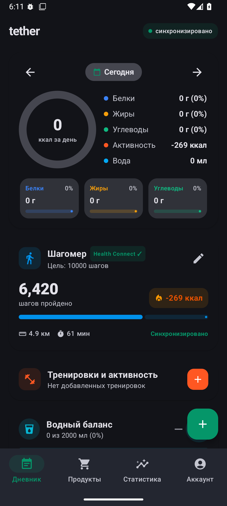
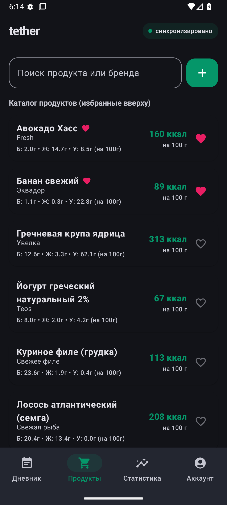
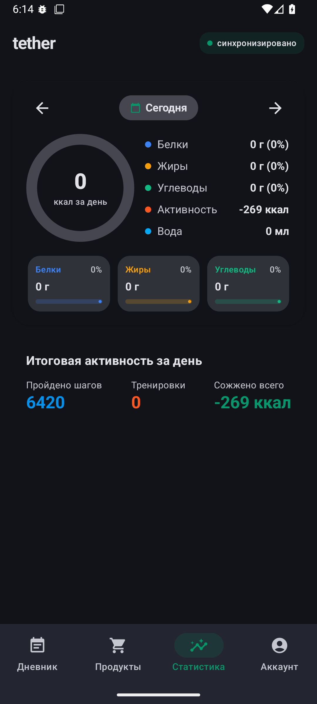
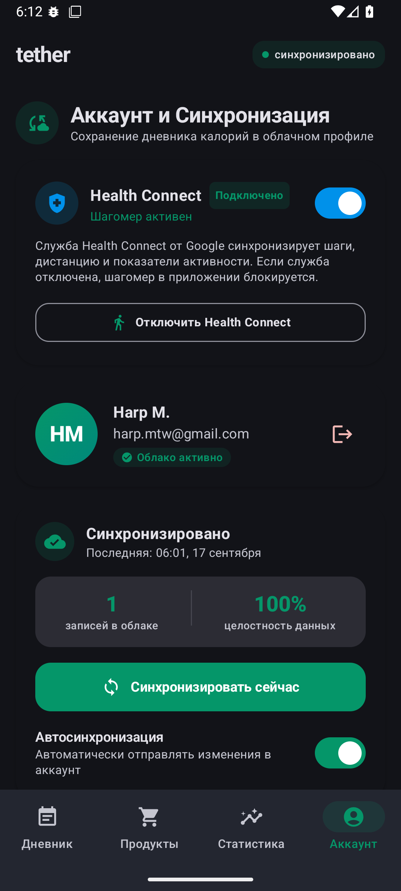

# Tether Mobile

Android-приложение для ведения дневника питания, подсчета калорий и макронутриентов (КБЖУ), контроля гидратации и учета физической активности с синхронизацией через REST API.

Проект разработан на Kotlin и Jetpack Compose в соответствии с рекомендациями Material Design 3 и Clean Architecture.

## Скриншоты

| Дневник | Каталог продуктов | Статистика | Профиль |
| :---: | :---: | :---: | :---: |
|  |  |  |  |

## Стек технологий

### Mobile (Android)
- **Язык и UI**: Kotlin 2.2, Jetpack Compose, Material 3.
- **Архитектура**: MVVM, unidirectional data flow (UDF), StateFlow.
- **Локальное хранилище**: Room Database (SQLite), DataStore.
- **Сетевой слой**: Retrofit 2, OkHttp 4, Moshi.
- **Асинхронность**: Kotlin Coroutines & Flow.
- **Тестирование**: JUnit 4, AndroidX Test Runner, Espresso.

### Backend (Сервисы)
- **Фреймворк**: FastAPI (Python 3.12+).
- **База данных**: SQLite (локальная разработка) / PostgreSQL (продакшн), SQLAlchemy 2.0 ORM.
- **Аутентификация**: JWT Bearer токены, bcrypt.
- **Тестирование**: Pytest, FastAPI TestClient.

## Структура проекта

```text
tether/
├── app/                        # Android приложение
│   ├── src/main/java/          # Исходный код (UI, Data, Domain, API)
│   ├── src/main/res/           # Ресурсы (макеты, иконки, темы)
│   └── build.gradle.kts        # Конфигурация сборки модуля
├── backend/                    # Backend микросервисы
│   ├── pyth/auth/              # Сервис авторизации (порт 8001)
│   ├── pyth/diary/             # Сервис дневника и аналитики (порт 8002)
│   ├── tests/                  # Pytest тесты эндпоинтов
│   └── run_backend.py          # Скрипт запуска и инициализации БД
├── .github/workflows/          # CI/CD пайплайны GitHub Actions
└── build.gradle.kts            # Корневой скрипт сборки Gradle
```

## Сборка и запуск

### Требования
- JDK 17 (Eclipse Temurin или OpenJDK)
- Android SDK (API 34–36, Build-Tools)
- Python 3.12+ (для запуска локального бэкенда)

### Мобильное приложение
Сборка отладочной версии APK:
```bash
./gradlew assembleDebug
```

Запуск юнит-тестов:
```bash
./gradlew testDebugUnitTest
```

### Локальный бэкенд
Установка зависимостей и запуск сервисов авторизации и дневника:
```bash
pip install -r backend/requirements-dev.txt
python backend/run_backend.py
```
После запуска доступны:
- Auth API Docs: `http://localhost:8001/docs`
- Diary & Analytics API Docs: `http://localhost:8002/docs`

## CI/CD

В проекте настроен GitHub Actions пайплайн (`.github/workflows/android-ci.yml`), выполняющий:
1. Статический анализ кода (`lintDebug`).
2. Прогон юнит-тестов (`testDebugUnitTest`).
3. Сборку APK (`assembleDebug`) с выгрузкой артефакта `tether-debug.apk`.
